# 实践项目2：个人实验报告

## 1. 基本信息

- GitHub 登录名：dx0110
- 个人主页：[dx0110](https://github.com/dx0110)
- 个人仓库地址：[dx0110/my-docs](https://github.com/dx0110/my-docs)
- 最终网站地址：[我的技术文档](https://dx0110.github.io/my-docs/)
- 实践日期：2026 年 11 月 8 日
- 实践环境：Windows、PowerShell、Python 虚拟环境、Git、MkDocs Material。

这个项目，是为了练习通过 GitHub Actions 自动部署静态文档到 GitHub Pages，构建自己的个人网页。下面结合我的实际截图、提交记录和配置，说明从创建仓库到验证自动更新的过程。实践开始时尚未遇到问题，后续在预览和推送阶段遇到了依赖、授权及网络问题，处理过程记录在第 3 节。

## 2. 实践过程与关键截图

### 2.1 仓库创建

在 GitHub 上创建公开仓库 `dx0110/my-docs`，使用 `main` 作为主分支，并初始化 README。这样既能保存文档源文件和版本历史，也能让后续 Actions 工作流从仓库获取内容。下图可以看到仓库为 Public、分支为 `main`，初始提交为 `d25c66f`，当时仓库中只有 README，说明仓库已创建成功。

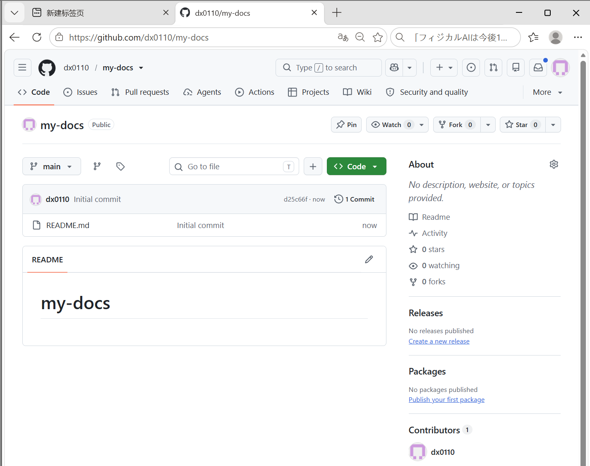

随后我将仓库克隆到本地，进入项目目录，再添加站点内容和配置：

```powershell
git clone https://github.com/dx0110/my-docs.git
cd my-docs
git branch --show-current
```

### 2.2 项目结构与 MkDocs 配置

我建立了 `docs/`、`report/images/` 和 `.github/workflows/`，分别保存网站内容、报告截图和自动部署工作流。分开存放可以明确哪些文件参与网站构建，哪些文件用于记录实践过程。

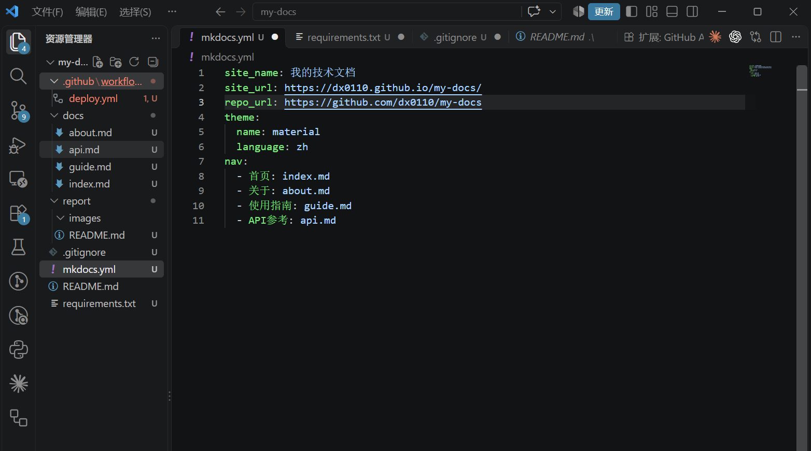

在 `mkdocs.yml` 中填写自己的站点与仓库地址，选择 Material 主题、中文界面，并配置四页导航。项目网站部署在 `/my-docs/` 下，因此 `site_url` 包含仓库名：

```yaml
site_name: 我的技术文档
site_url: https://dx0110.github.io/my-docs/
repo_url: https://github.com/dx0110/my-docs
theme:
  name: material
  language: zh
nav:
  - 首页: index.md
  - 关于: about.md
  - 使用指南: guide.md
  - API参考: api.md
```

保留了四页原有内容，再添加项目介绍、实践体会、导航表格、操作示例及 API 字段说明，使每页都有标题和实质内容，而不是只替换示例中的姓名。依赖清单包含 `mkdocs>=1.6,<2` 和 `mkdocs-material>=9.6,<10`；`.gitignore` 排除了 `.venv/`、`site/` 和 `__pycache__/`，避免提交本地环境和生成文件。

### 2.3 本地构建或预览

使用独立虚拟环境安装依赖，减少不同项目依赖之间的影响。激活环境后，先执行严格构建，再启动本地预览：

```powershell
python -m venv .venv
.\.venv\Scripts\Activate.ps1
python -m pip install -r requirements.txt
python -m mkdocs build --strict
python -m mkdocs serve
```

下图中的 `Documentation built in 3.62 seconds` 表明严格构建完成；随后日志显示 `Serving on http://127.0.0.1:8000/my-docs/`，说明预览服务已启动。终端还出现了主题生命周期提示。

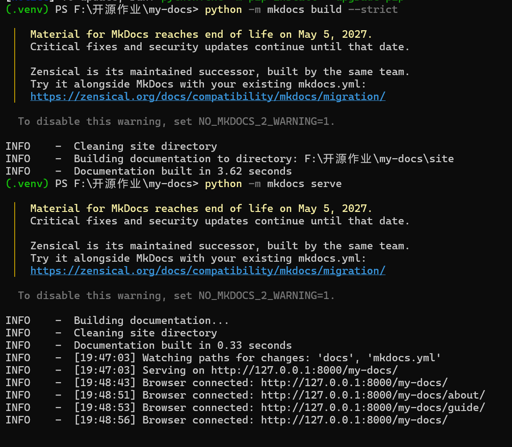

我根据终端给出的地址打开浏览器，确认首页能显示个人介绍和左侧四页导航：

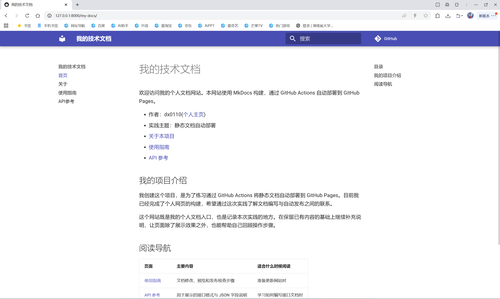

为了确认 Markdown 渲染效果，我查看了关于页面的技术组成表格，表头、行列与内容能够正常显示。

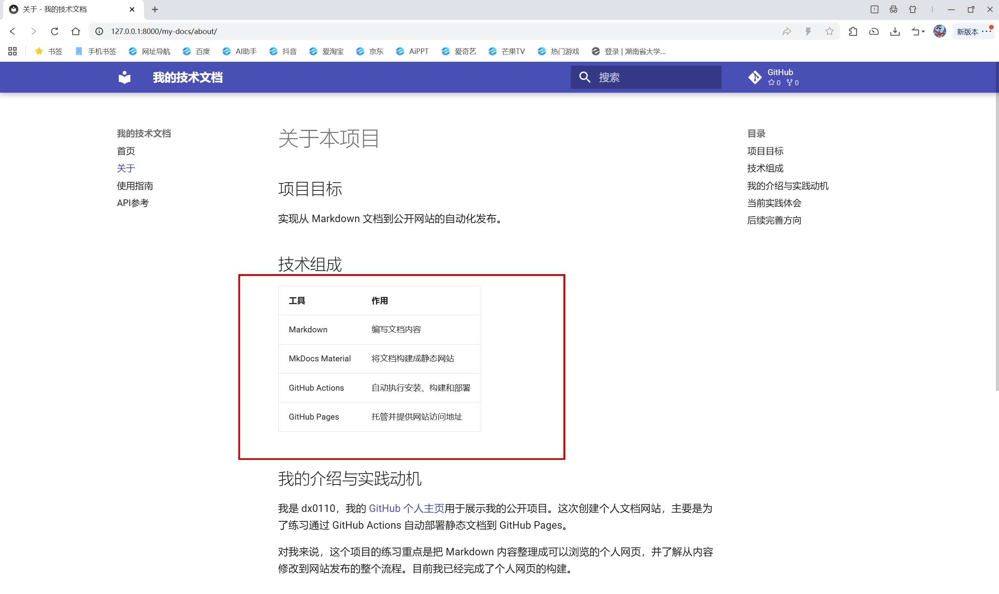

查看了 API 参考页面的 JSON 示例，确认代码块保留了缩进和结构。本页接口只是文档示例，不是真实后端服务。

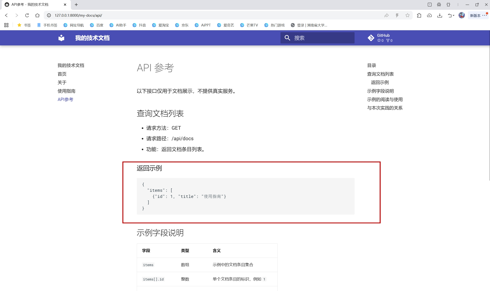

导航检查中，核对了左侧四页入口、右侧页内目录和正文中的页面链接。这些入口帮助读者切换页面，也能快速定位同一页的不同章节。

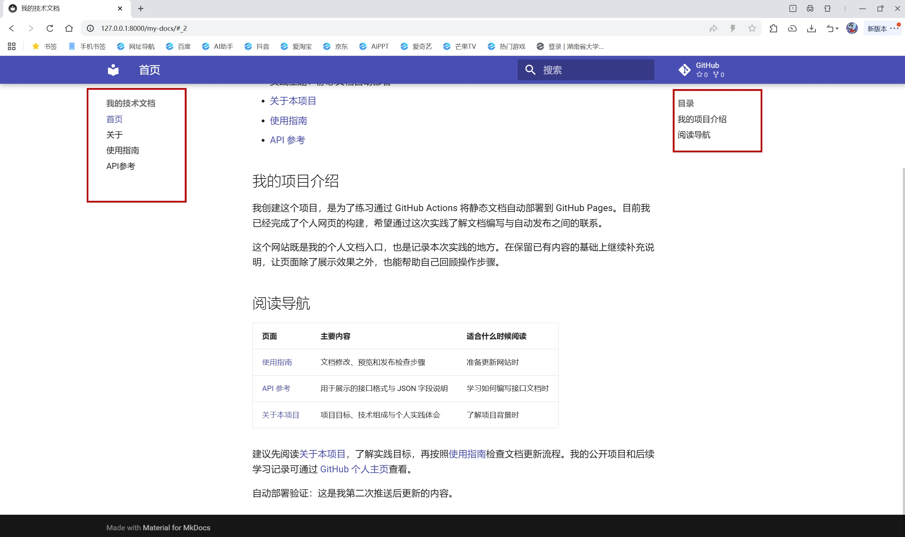

### 2.4 Pages 设置

进入仓库的 `Settings → Pages`，将 `Build and deployment` 下的 Source 设为 **GitHub Actions**。本次网站由工作流构建并上传产物，因此选择 Actions 作为发布来源。下图中的选中项为 GitHub Actions，与后续工作流方案一致。

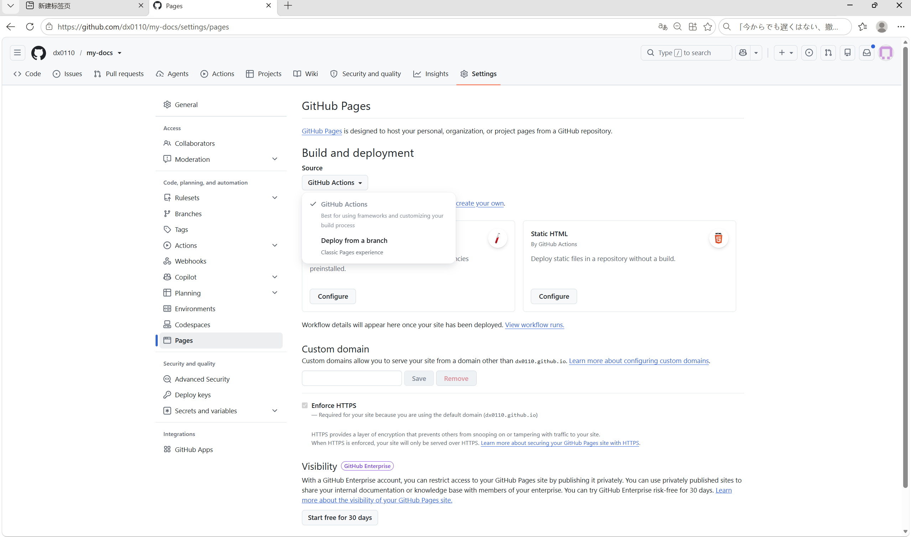

### 2.5 Actions 首次构建和部署

将文档、配置、依赖清单和工作流提交并推送到 `main`。首次站点提交为 [`9f6a557`](https://github.com/dx0110/my-docs/commit/9f6a557af6008786324e04bd6f004a5a346aa380)，提交说明为“搭建MkDocs文档并配置Pages自动部署”。推送前遇到的授权和连接问题见第 3 节。

推送成功后，GitHub 自动运行 `Deploy MkDocs to GitHub Pages`。在[首次运行记录](https://github.com/dx0110/my-docs/actions/runs/42480568703)中核对了触发方式、提交编号、分支和任务状态。下图显示由 push 触发，关联提交为 `9f6a557`，`build` 与 `deploy` 均为绿色，整体状态为 Success，用时 35 秒，并提供了网站地址。

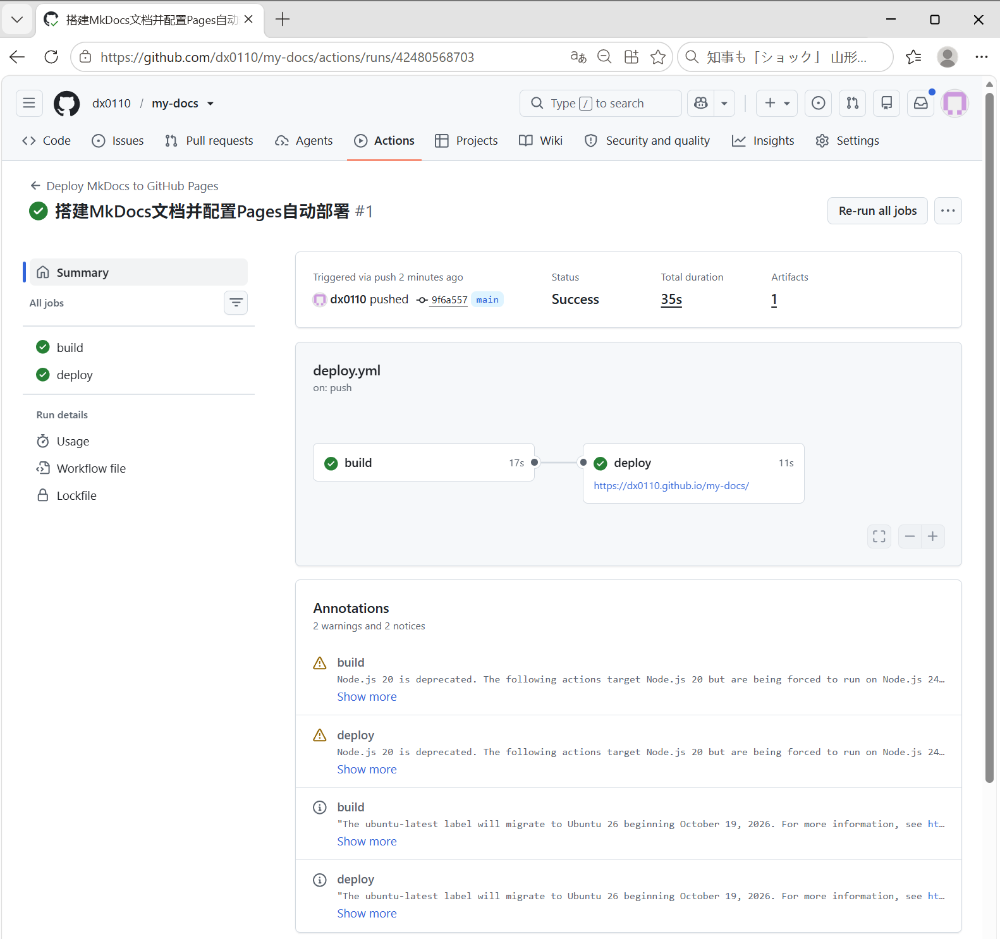

结合实际工作流，`build` 获取源码、配置 Python、安装依赖、严格构建并上传 `site/`；`deploy` 在构建成功后将产物发布到 Pages。概览下方仍有运行环境相关的 warnings 和 notices，因此这里记录为“运行成功”，不写成“完全没有提示”。

### 2.6 网站访问与四页导航检查

部署完成后，我通过公开地址访问网站，逐页查看首页、关于、使用指南和 API 参考。以下截图的地址栏均为 `dx0110.github.io/my-docs/` 下的公开地址，说明查看的是线上网站。

| 页面 | 公开地址 | 检查内容 |
| --- | --- | --- |
| 首页 | [打开首页](https://dx0110.github.io/my-docs/) | 个人介绍、阅读导航表格和页面链接 |
| 关于 | [打开关于页面](https://dx0110.github.io/my-docs/about/) | 项目目标、技术组成和实践动机 |
| 使用指南 | [打开使用指南](https://dx0110.github.io/my-docs/guide/) | 操作步骤、本地命令和代码示例 |
| API 参考 | [打开 API 参考](https://dx0110.github.io/my-docs/api/) | 示例用途、请求信息和 JSON 代码块 |

首页显示我的 GitHub 登录名、项目介绍和阅读导航，说明个人内容已发布，且能从首页找到其他文档入口。

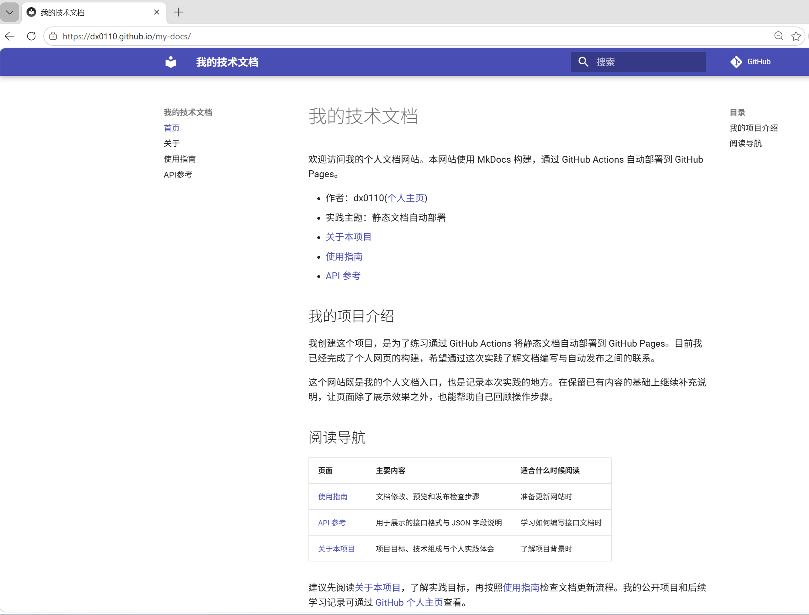

关于页面显示项目目标、技术组成表格和实践动机，页面不只有标题。

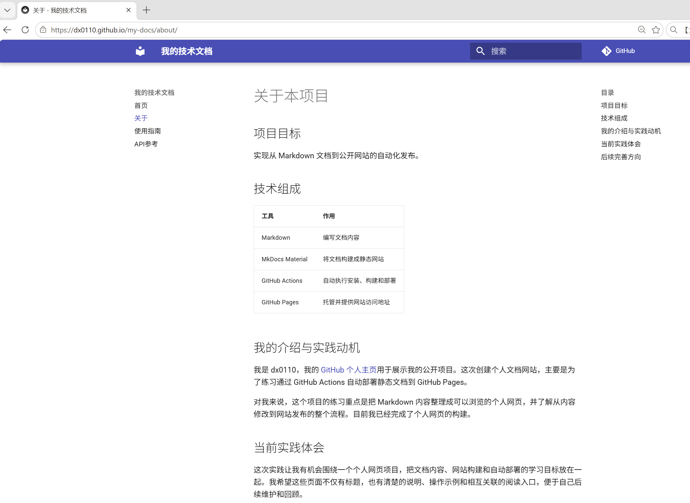

使用指南显示五步操作流程与本地预览代码块，说明步骤列表和代码示例在线上仍能正常显示。

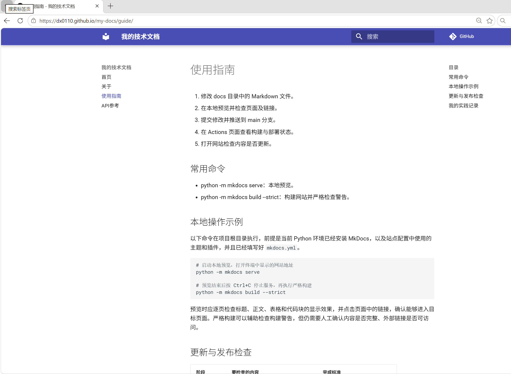

API 参考显示请求方法、演示路径、JSON 示例和字段表格，并保留“不提供真实服务”的说明，避免把示例误认为真实接口。

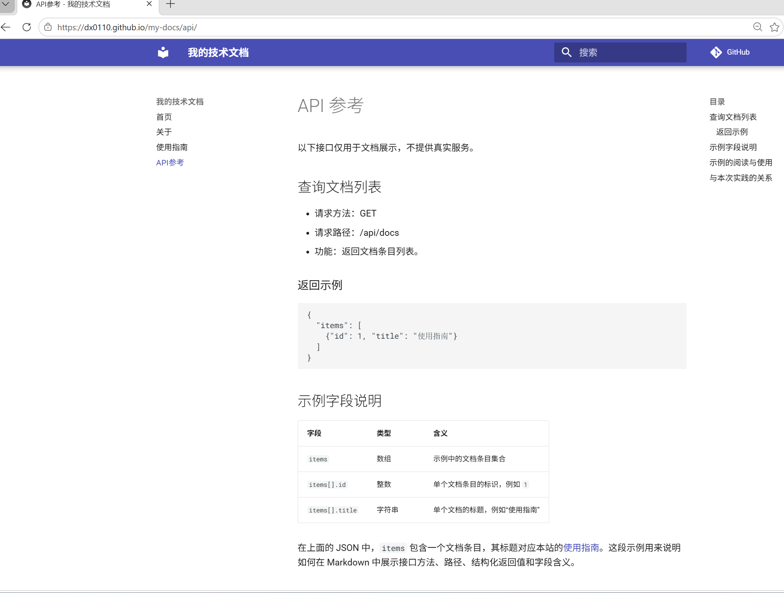

### 2.7 第二次推送与自动更新验证

为了验证后续修改也能自动发布，我在 `docs/index.md` 末尾新增一行容易辨认的文字：

```text
自动部署验证：这是我第二次推送后更新的内容。
```

本次提交说明为“验证文档修改后自动更新网站”。修改的是 `docs/` 中的文件，推送到 `main` 后符合工作流路径过滤条件，自动触发了第二次运行。

- 对应提交链接：[d055bc778f9c23b9caf223ea68a963ef66fabab0](https://github.com/dx0110/my-docs/commit/d055bc778f9c23b9caf223ea68a963ef66fabab0)
- 对应 Actions 运行链接：[第二次运行 #2](https://github.com/dx0110/my-docs/actions/runs/42481350790)

下图显示运行标题与本次提交说明一致，关联提交为 `d055bc7`，两个任务均成功，整体用时 52 秒，说明后续文档修改也能完成自动构建和部署。

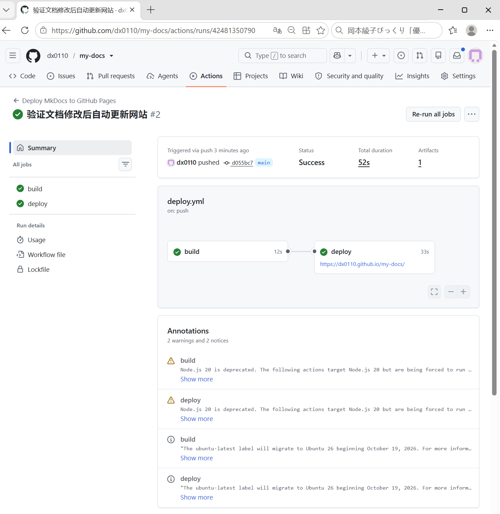

随后我刷新公开网站，在首页底部看到了新增的验证文字。将提交内容、第二次运行记录与线上显示结果对应起来，可以确认这次更新已经发布，而不只是本地文件发生了变化。

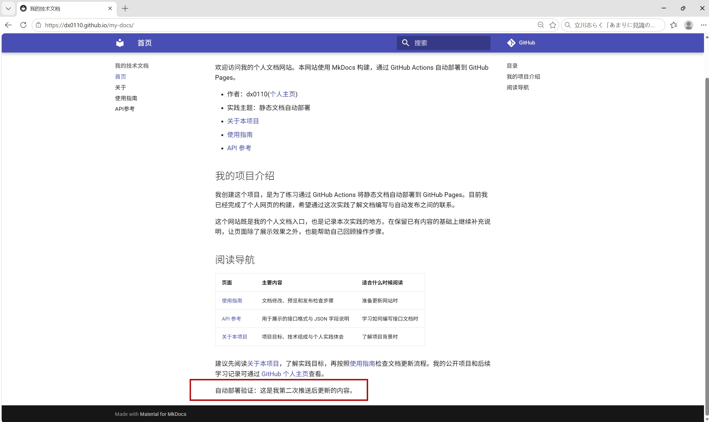

## 3. 问题与解决

### 3.1 启动预览时没有 MkDocs 模块

最初我已创建并激活虚拟环境，但执行构建和预览命令时没有出现访问地址，而是提示：

```text
No module named mkdocs
```

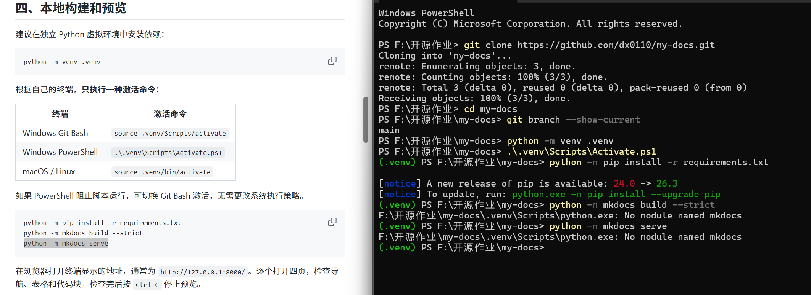

当时 `requirements.txt` 尚为空，安装命令没有读到任何依赖，因此未安装 MkDocs。激活虚拟环境只表示切换了 Python 环境，不代表依赖已经安装。补充并保存依赖清单后，在虚拟环境中重新安装，再执行构建和预览，最终得到第 2.3 节所示的构建完成日志及访问地址。

这让我认识到，pip 升级提示不是构建错误；应首先查看实际报错，确认依赖文件已经保存且包含需要安装的软件包。

### 3.2 推送工作流时缺少授权

首次推送包含 `.github/workflows/deploy.yml`，GitHub 拒绝更新，关键日志为：

```text
refusing to allow an OAuth App to create or update workflow
without `workflow` scope
```

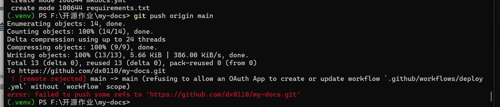

当前推送凭据缺少修改工作流文件的授权，并不是 Markdown 或 YAML 已经构建失败。我通过 GitHub 网页生成包含公开仓库访问权限和 `workflow` 权限的个人访问令牌，推送时临时跳过旧凭据缓存，用自己的登录名和新令牌认证。令牌仅在密码提示处输入，不写入仓库或报告。

仓库的 Actions 运行设置与本地 Git 凭据授权是两个环节，修改 Actions 设置不能直接补上推送凭据缺少的权限。

### 3.3 连接重置、超时及推送结果判断

处理授权后，我又多次遇到连接重置、HTTPS 超时和传输中断：

```text
Recv failure: Connection was reset
Failed to connect to github.com:443
send-pack: unexpected disconnect while reading sideband packet
fatal: the remote end hung up unexpectedly
```

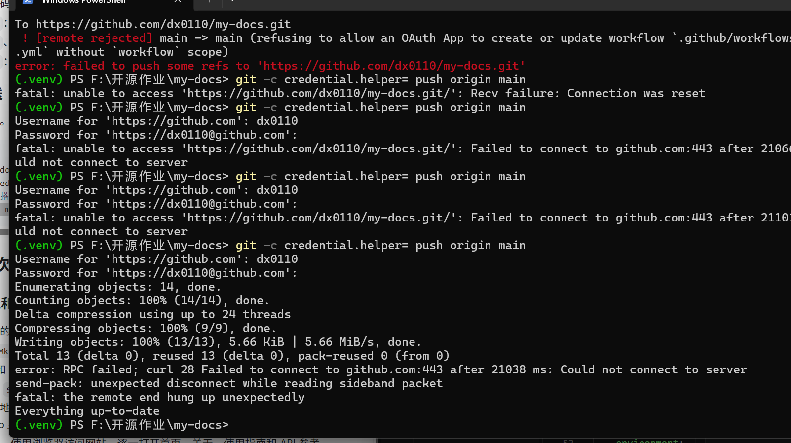

这些日志说明连接未稳定完成，但不能据此确定具体是哪段网络或代理导致问题。一次失败输出中还出现了 `Everything up-to-date`，因此我没有仅凭最后一句话判断成功，而是尝试查询本地和远程的提交编号：

```powershell
git rev-parse HEAD
git ls-remote origin refs/heads/main
```

查询远程时也曾遇到连接重置。之后我使用下面的命令重试，临时指定 HTTP/1.1 并跳过旧凭据。这些参数仅作用于本次命令，没有修改全局 Git 设置：

```powershell
git -c http.version=HTTP/1.1 -c credential.helper= push origin main
```

最终日志明确显示 `d25c66f..9f6a557 main -> main`，没有随后的失败信息。后续首次 Actions 运行也关联到 `9f6a557`，进一步确认 GitHub 收到了提交。这里记录的是重试成功的结果，不表示已经确定所有网络中断的根因。

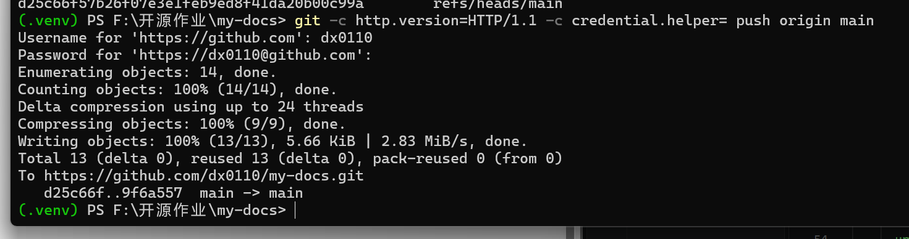

这些问题让我学会区分依赖缺失、权限不足与网络故障。网络错误不需要通过删除仓库、重新提交或 `git reset` 来处理，应该先查看日志并核对远程状态。

## 4. 原理理解

### 4.1 docs/ 和 site/ 各保存什么？为什么不用手工修改 site/？

`docs/` 保存维护的 Markdown 源文件，本项目四页内容都在这里；`site/` 保存 MkDocs 构建生成的 HTML、样式和脚本等静态资源，是浏览器使用的网站产物。

应修改 `docs/` 或 `mkdocs.yml` 后重新构建，因为手工修改 `site/` 不会更新源文件，下次构建重新生成产物时还可能被覆盖。本次 `.gitignore` 已忽略 `site/`，远程构建由 Actions 根据源文件重新完成。

### 4.2 本次工作流在什么情况下自动运行？

根据本仓库的 [deploy.yml](../.github/workflows/deploy.yml)，push 自动触发需要同时满足两个条件：目标分支为 `main`，且推送涉及以下任一路径：

```yaml
on:
  push:
    branches: [main]
    paths:
      - 'docs/**'
      - 'mkdocs.yml'
      - 'requirements.txt'
      - '.github/workflows/deploy.yml'
  workflow_dispatch:
```

此外，`workflow_dispatch` 支持从 Actions 页面手动运行。第二次验证修改 `docs/index.md`，满足自动触发的分支与路径条件，因此运行了部署 #2。

### 4.3 build 与 deploy 两个任务有什么区别？

| 任务 | 本次工作流中的职责 | 结果 |
| --- | --- | --- |
| `build` | 检出源码、配置 Python 3.12、配置 Pages、安装依赖、严格构建并上传 `site/` | 生成供部署使用的网站产物 |
| `deploy` | 在 `build` 成功后，使用 `actions/deploy-pages` 发布产物 | 更新 GitHub Pages 网站 |

`deploy` 通过 `needs: build` 依赖构建任务，构建失败时不会继续正常部署。部署任务拥有 `pages: write` 与 `id-token: write` 权限，使用 `github-pages` 环境，不重新编写文档，也不替代前面的严格构建。

### 4.4 只修改 report/README.md 会触发部署吗？为什么？

按当前配置，一次推送如果只修改 `report/README.md`，不会自动触发本工作流，因为 `report/` 不在 `push.paths` 范围内。只改报告图片或根目录 README 也是如此，可以避免整理报告时无意义地重建网站。

如果同一次推送还修改了 `docs/` 等匹配路径，则仍会触发；手动运行也不受本次 push 路径过滤限制。因此，提交报告后没有新增部署记录是预期行为，不能据此判断推送失败。

### 4.5 本次方案为何无需创建 gh-pages 分支？

Pages 来源选择了 GitHub Actions。工作流先通过 `actions/upload-pages-artifact` 上传 `site/` 构建产物，再通过 `actions/deploy-pages` 发布，不依赖把 HTML 提交到 `gh-pages` 分支。

只需维护主分支上的源文件、配置和工作流，无需手动创建或维护存放生成网页的专用分支。构建与发布结果可以在每次 Actions 记录中追踪。

## 5. 实践体会

我最初的目标是构建个人网页并练习自动部署。完成后，我不仅看到了自己的公开文档网站，也通过第二次修改验证了“更新源文件—推送提交—自动构建—自动发布—线上确认”的过程。

这次最有帮助的经验是不要把“执行了命令”和“操作成功”视为同一件事：预览需要看到服务地址，推送需要确认远程更新，部署需要核对任务状态，网站更新还要以公开页面中的新增文字为证据。以后维护项目时，我会继续记录实际日志和处理结果，让报告能够与截图、提交记录相互对应。

[返回项目说明](../README.md) · [访问文档网站](https://dx0110.github.io/my-docs/)
